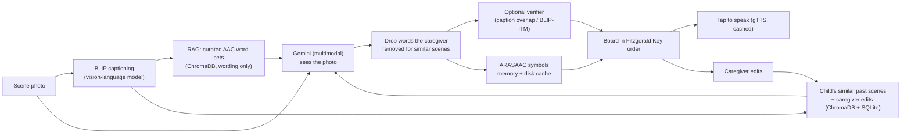

# SceneSpeak

**Photo in, communication board out.** SceneSpeak turns a photo of a child's surroundings into an
AAC (Augmentative and Alternative Communication) board — picture symbols a nonverbal or minimally
verbal child can point to and tap to hear — for speech-language pathologists, teachers and families.

<!-- Demo GIF: record uploading a photo → board → tapping tiles → Edit, then replace this line with
      -->
*Demo GIF coming soon.*

## How it works



1. **Caption** — BLIP describes the photo; the caption drives retrieval and is shown on the board.
2. **Retrieve** — the caption searches ~800 curated AAC words across 36 everyday scenarios, used only to
   set *standard wording*; and the child's **own most similar past scenes**, with the caregiver's edits.
3. **Generate** — Gemini sees the photo itself and returns words by part of speech, laid out in modified
   Fitzgerald Key order (people → actions → prepositions → describing → things), following QuickPic AAC.
4. **Personalise** — words the caregiver removed for similar scenes are dropped; words they added are offered.
5. **Verify (optional)** — a pluggable verifier scores object words against the photo; doubtful words are
   **greyed out, never deleted** — the caregiver decides.
6. **Symbols & speech** — ARASAAC pictograms; tapping a tile speaks the word.

Privacy: no accounts. Each browser holds a random key, and a child's boards, photos list and history are
stored under a hash of it — another visitor typing the same child's name sees nothing.

## Results

Every number below comes from a recorded script run in [`RESULTS.md`](RESULTS.md) (command, date, raw output).

| What was measured | Result |
|---|---|
| Wording consistency across repeated boards (Jaccard, 14 photos × 3 runs) | 0.731 without RAG · 0.724 with RAG · **0.960 with RAG + child history** |
| Share of words from the curated AAC word sets | 59.1% without RAG → **64.9%** with RAG |
| Captioning on 50 COCO scenes (CIDEr / BLEU-4) | BLIP base 1.288 / 0.405 · **fine-tuned BLIP 1.340 / 0.418** · Gemini 1.016 / 0.252 |
| Other requests blocked while a board generates (`/health`, median) | **8,297 ms → 28 ms** after moving generation off the event loop |
| Board generation time (server, p50, 5 boards) | 8.50 s → 7.76 s (cold symbol cache) / 6.48 s (warm) — within Gemini's own variance |
| Board precision / hallucination on labelled scenes | *Pending: full evaluation on the reviewed 50-image set* |

Findings that changed the design: an earlier **CLIP filter** rejected objects that were clearly visible on
real photos, so it was removed; **RAG didn't improve consistency** — child history did — so retrieval was
redesigned around each child's own boards; a caption **repetition penalty** made no measurable difference,
so it was dropped.

## Run it

```bash
python -m venv .venv
.venv\Scripts\activate              # Windows  (source .venv/bin/activate elsewhere)
pip install -r requirements.txt
copy .env.example .env              # then set GEMINI_API_KEY
python run.py                       # http://127.0.0.1:8000
```

Or with Docker (CPU-only image): `docker compose up --build`, then open http://127.0.0.1:8000.
See [`docs/DEPLOY.md`](docs/DEPLOY.md) for Hugging Face Spaces.

Settings:

| Where | Setting | Default |
|---|---|---|
| `.env` | `GEMINI_API_KEY` | — (required) |
| `.env` | `DAILY_BOARD_LIMIT` — boards per day on the server's key | 30 |
| env / `config/verification.json` | `VERIFIER` — `none`, `caption_overlap` or `blip_itm` | `none` |
| `config/generation.json` | `rag_mode` (`wording` / `suggest`), `personalization` (`similar_scenes` / `full_history`) | `wording`, `similar_scenes` |

## Tests and evaluation

```bash
pip install -r requirements-dev.txt
python -m pytest --cov=app --cov=eval.metrics           # offline, no API calls

python eval/list_unlabeled.py                            # dataset status
python eval/run_eval.py --limit 5                        # smoke test (Gemini calls)
python eval/run_eval.py --runs 3                         # full: configs A0, A, B, C, D, E
python eval/caption_eval.py --captions <captions_val2017.json>
python scripts/profile_board.py --label <name>           # latency profile
```

Evaluation configurations: **A0** caption only · **A** Gemini with the photo · **B** + RAG (original
"suggest" mode) · **C/D** B + caption-overlap / BLIP-ITM verifier · **E** + RAG ("wording" mode, the
default). The dataset is 50 COCO val2017 images across 10 child-relevant scenes, with labels pre-filled
from COCO annotations and POPE-style "plausible but absent" negatives — see
[`eval/dataset/README.md`](eval/dataset/README.md).

## Research basis

- **QuickPic AAC** (Yu et al., *IJERPH* 2024) — LLM-generated topic displays in Fitzgerald Key order;
  speech therapists kept 58% of GPT-3.5's words.
- **Zastudil et al.** (2024) — GPT-4V generating options for visual scene displays from the photo itself.
- **POPE** (Li et al., EMNLP 2023) — vision-language models name objects that typically co-occur but
  aren't there; used for the evaluation's negative labels.
- **"Empowering AAC Users"** (CustomNLP4U 2024) — retrieval over a user's own content for personalisation.

## Limitations and ethics

- **Not a medical device** and not a substitute for a speech-language pathologist. Boards are suggestions;
  the caregiver reviews and edits every board.
- No user study yet. The planned pilot ([`pilot/`](pilot/)) asks special educators to rate board relevance;
  until then, all quality numbers are automatic.
- Automatic labels come from COCO's 80 object types plus manual review, so "precision" undercounts
  visible objects that aren't listed.
- Photos are sent to Google Gemini. On Gemini's free tier Google may use submitted content to improve its
  products, and its terms ask not to send personal information — use a paid key before real families use
  it, and prefer photos of places over children's faces.
- Without accounts, clearing browser data loses access to that browser's boards.

## Credits

Pictographic symbols: Sergio Palao, [ARASAAC](https://arasaac.org) (Government of Aragón), CC BY-NC-SA.
Evaluation images and captions: [COCO](https://cocodataset.org) val2017 (per-image licences recorded in
the label files). Captioning model: [BLIP](https://huggingface.co/Salesforce/blip-image-captioning-base) (Salesforce).
